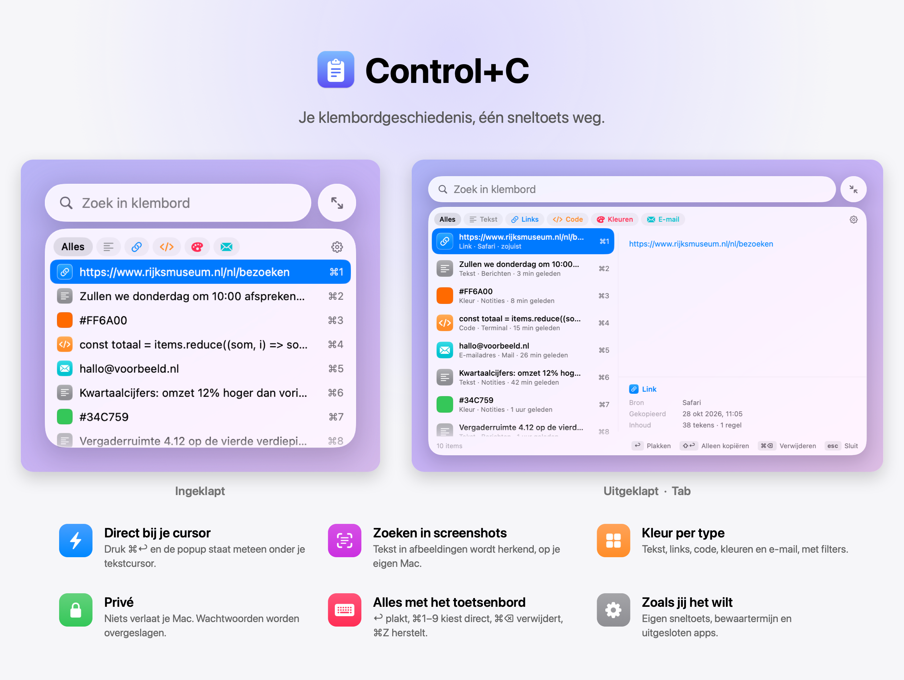

<p align="center"></p>

# Control+C

[English](README.md)

Met Control+C zie je je klembordgeschiedenis meteen voor je. Druk op **⌘↩** (Command + Enter), waar je ook bent, en er verschijnt een klein menu onder je tekstcursor met wat je de afgelopen tijd hebt gekopieerd. Je hoeft geen Spotlight te openen of eerst op een icoontje te klikken.

## Installeren

Je hebt nodig: macOS 26 (Tahoe) of nieuwer, en de Command Line Tools van Xcode.

```bash
xcode-select --install
```

Haal daarna de repo op en bouw de app:

```bash
git clone https://github.com/SvenwifAI/control-c.git
cd control-c
./build.sh
```

`build.sh` bouwt de app uit de broncode in `Sources/`, zet hem in `/Applications/ControlC.app` en start hem. Er wordt niets gedownload.

**Automatisch plakken:** de eerste keer vraagt macOS om toegang via Systeeminstellingen → Privacy en beveiliging → **Toegankelijkheid**. Zet Control+C daar aan. Zonder die toegang wordt een item alleen gekopieerd en plak je zelf met ⌘V. De app opent dan ook bij je muis in plaats van bij je tekstcursor.

**Instellingen:** klik op het klembord-icoon in de menubalk en kies *Instellingen…*, of druk op `⌘,` of het tandwiel in de popup. Daar kies je je eigen sneltoets, hoeveel items hij bewaart en hoe lang, welke apps hij moet negeren, en of hij moet starten bij inloggen.

## Gebruik

| | |
|---|---|
| `⌘↩` | Popup openen of sluiten |
| Typen | Zoeken |
| `↑` `↓` | Item kiezen |
| `↩` of dubbelklik | Plakken in de app waar je was |
| `⇧↩` of één klik | Alleen kopiëren |
| `⌘1` … `⌘9` | Item 1 t/m 9 meteen plakken |
| `⌘←` `⌘→` of de filterknoppen | Alleen tekst, links, afbeeldingen, code, kleuren of e-mailadressen |
| `tab` of het pijltjesknopje | Grote weergave met voorbeeld |
| `⌘⌫`, × of rechtermuisklik | Item verwijderen |
| `⌘Z` | Verwijderen ongedaan maken |
| `⇧⌘⌫` | Alles wissen (vraagt eerst om bevestiging) |
| `⌘,` | Instellingen |
| `esc` | Sluiten |

**Taal:** de app volgt de taal van je Mac: Nederlands als je Mac in het Nederlands staat, anders Engels.

**Zoeken in screenshots:** in gekopieerde afbeeldingen wordt de tekst herkend, zodat je daar ook in kunt zoeken. Met een rechtermuisklik op een afbeelding kopieer je die tekst. Dit gebeurt met Apple Vision op je eigen Mac. Uitzetten kan in Instellingen.

## Privacy en veiligheid

- **Alles blijft op je Mac.** De app maakt geen internetverbinding.
- **Wachtwoorden uit wachtwoordmanagers** (1Password, iCloud-sleutelhanger, Bitwarden en andere apps die hun kopieën als geheim markeren) worden niet opgeslagen.
- **Je geschiedenis staat in** `~/Library/Application Support/ControlC/`. Alleen jouw gebruikersaccount kan die map lezen en hij gaat niet mee in Time Machine-backups.
- **Items verlopen na 7 dagen** zonder gebruik, en er worden hooguit 60 items bewaard. Beide kun je aanpassen in Instellingen (1, 7 of 30 dagen; 20 tot 200 items). Teksten groter dan 1 MB en afbeeldingen groter dan 20 MB worden niet bewaard.
- **Apps uitsluiten:** wat je kopieert in apps die je in Instellingen uitsluit, wordt nooit bewaard.
- **Let op:** wat je zonder wachtwoordmanager kopieert, bijvoorbeeld een wachtwoord uit een notitie of een 2FA-code, komt wel in de geschiedenis. Verwijder zo'n item met `⌘⌫`.
- De toestemming voor Toegankelijkheid gebruikt de app alleen om je tekstcursor te vinden en om ⌘V te versturen.
- **Gebruik alleen een versie die je zelf hebt gebouwd.** Neem geen kant-en-klare `.app` van iemand anders over: die kun je niet controleren en hij krijgt wel toegang tot je klembord en tot Toegankelijkheid.

## Sneltoets aanpassen

⌘↩ verstuurt ook berichten in apps als Slack, Teams en Claude. Kies in Instellingen een andere combinatie: klik op de sneltoets en druk de nieuwe in, bijvoorbeeld ⌥V of ⌘⇧V.

## Toestemming na elke nieuwe versie (optioneel)

macOS koppelt de Toegankelijkheid-toestemming aan de handtekening van de app. Zonder eigen certificaat moet je die toestemming daarom na elke `./build.sh` opnieuw aanzetten. Maak je in Sleutelhangertoegang een eigen certificaat voor codeondertekening met de naam **Control+C Signing** (Certificaatassistent → Maak een certificaat aan → type *Codeondertekening*), dan gebruikt `build.sh` dat automatisch en blijft de toestemming geldig.

## Verwijderen

```bash
pkill -x ControlC; rm -rf /Applications/ControlC.app ~/Library/Application\ Support/ControlC
```

Haal Control+C daarna ook weg uit Toegankelijkheid en uit je inlogonderdelen.

## Licentie

[MIT](LICENSE)
